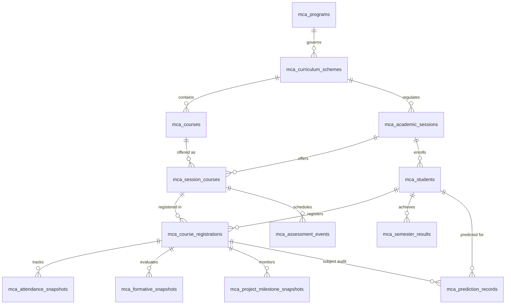

# Database Architecture & Entity-Relationship Specifications

**Database Target:** `mca_academic_system` (MySQL 8.0 / PyMySQL)  
**Schema Model Count:** Exactly 13 approved tables  
**Isolation Rule:** Complete segregation from legacy Phase 1 UCI schema  

---

## 1. Approved 13-Table MCA Architecture

The MCA database structure enforces relational integrity across four academic domains: **Curriculum Definition**, **Student Enrollment**, **Temporal Academic Snapshots**, and **Prediction Audit Persistence**.

---

## 2. Table Catalog and Schema Details

### 2.1 Curriculum & Academic Infrastructure
1. **`mca_programs`**: Master record for the academic program.
   - Primary Key: `id` (INT, autoincrement)
   - Columns: `program_name` (VARCHAR 200, UNIQUE), `program_code` (VARCHAR 50, UNIQUE, e.g. "MCA"), `duration_semesters` (INT, default 4).
2. **`mca_curriculum_schemes`**: Governing autonomous regulations.
   - Primary Key: `id` (INT, autoincrement)
   - Columns: `program_id` (FK -> `mca_programs.id`), `scheme_name`, `scheme_code` (VARCHAR 100, UNIQUE), `effective_from` (VARCHAR 50), `is_active` (BOOLEAN).
   - Seeded Schemes:
     * `MCA-AUTONOMOUS-2025` (effective July 2025, governing Semester 1)
     * `MCA-AUTONOMOUS-2024` (effective July 2024, governing Semester 3)
3. **`mca_courses`**: Canonical 26-course catalogue across 4 semesters (7 / 7 / 7 / 5).
   - Primary Key: `id` (INT, autoincrement)
   - Columns: `scheme_id` (FK -> `mca_curriculum_schemes.id`, NULLABLE), `course_code` (VARCHAR 50, NULLABLE), `course_name` (VARCHAR 255), `semester_number` (INT, 1 to 4), `course_type` (ENUM: 'theory', 'lab', 'elective', 'project'), `credits` (INT, NULLABLE), `elective_group` (VARCHAR 50, NULLABLE).
   - Verification Status:
     * **Semester 1 (7 courses)**: Verified codes (`MCA108`–`MCA114`), verified credits, mapped to `MCA-AUTONOMOUS-2025`.
     * **Semester 2 (7 courses)**: Provisional (code=NULL, credits=NULL, scheme_id=NULL pending university publication).
     * **Semester 3 (7 courses)**: Verified codes (`MCA301`–`MCA307`), verified credits, mapped to `MCA-AUTONOMOUS-2024`.
     * **Semester 4 (5 courses)**: Provisional (code=NULL, credits=NULL, scheme_id=NULL pending university publication).
   - Constraints: `UNIQUE(scheme_id, semester_number, course_name)`.
4. **`mca_academic_sessions`**: Cohort batch timelines.
   - Primary Key: `id` (INT, autoincrement)
   - Columns: `scheme_id` (FK -> `mca_curriculum_schemes.id`), `session_name` (VARCHAR 100, UNIQUE), `batch_year` (VARCHAR 50, e.g. "2025-2027"), `start_date` (DATE), `end_date` (DATE).
5. **`mca_session_courses`**: Active course instances offered in an academic session.
   - Primary Key: `id` (INT, autoincrement)
   - Columns: `session_id` (FK -> `mca_academic_sessions.id`), `course_id` (FK -> `mca_courses.id`), `faculty_name` (VARCHAR 100, NULLABLE).
   - Constraints: `UNIQUE(session_id, course_id)`.

### 2.2 Student Enrollment & Assessment Schedule
6. **`mca_students`**: Enrolled MCA candidates.
   - Primary Key: `id` (INT, autoincrement)
   - Columns: `student_code` (VARCHAR 50, UNIQUE, e.g. "DEMO-MCA-2025-001"), `session_id` (FK -> `mca_academic_sessions.id`), `is_active` (BOOLEAN), `deactivated_at` (DATETIME, NULLABLE), `deactivation_reason` (VARCHAR 255, NULLABLE).
7. **`mca_course_registrations`**: Subject enrollments per candidate.
   - Primary Key: `id` (INT, autoincrement)
   - Columns: `student_id` (FK -> `mca_students.id`), `session_course_id` (FK -> `mca_session_courses.id`), `semester_number` (INT, 1 to 4), `is_active` (BOOLEAN).
   - Constraints: `UNIQUE(student_id, session_course_id)`.
8. **`mca_assessment_events`**: Scheduled formative examination milestones.
   - Primary Key: `id` (INT, autoincrement)
   - Columns: `session_course_id` (FK -> `mca_session_courses.id`), `event_name` (VARCHAR 100), `event_type` (VARCHAR 50: 'MST', 'ASSIGNMENT', 'LAB_VIVA', 'MAKEUP'), `max_marks` (DECIMAL 5,2), `event_date` (DATE, NULLABLE), `original_event_id` (FK -> `mca_assessment_events.id`, NULLABLE, self-referencing for makeup exams).
   - Constraints: Self-referencing constraint `original_event_id != id` enforced at application ORM layer (`@validates`) and SQLite DDL.

### 2.3 Temporal Point-in-Time Snapshots
9. **`mca_attendance_snapshots`**: Cumulative attendance at snapshot timestamp.
   - Primary Key: `id` (INT, autoincrement)
   - Columns: `registration_id` (FK -> `mca_course_registrations.id`), `classes_held` (INT), `classes_attended` (INT), `attendance_percentage` (DECIMAL 5,2), `revision_number` (INT), `recorded_at` (DATETIME).
   - Constraints: `UNIQUE(registration_id, revision_number)`.
10. **`mca_formative_snapshots`**: Continuous internal assessment progress.
   - Primary Key: `id` (INT, autoincrement)
   - Columns: `registration_id` (FK -> `mca_course_registrations.id`), `mst1_marks` (DECIMAL 5,2, NULLABLE), `mst2_marks` (DECIMAL 5,2, NULLABLE), `assignment_score` (DECIMAL 5,2, NULLABLE), `viva_marks` (DECIMAL 5,2, NULLABLE), `lab_record_score` (DECIMAL 5,2, NULLABLE), `revision_number` (INT), `recorded_at` (DATETIME).
   - Constraints: `UNIQUE(registration_id, revision_number)`.
11. **`mca_project_milestone_snapshots`**: Minor project progress (Semester 3/4).
   - Primary Key: `id` (INT, autoincrement)
   - Columns: `registration_id` (FK -> `mca_course_registrations.id`), `milestone_name` (VARCHAR 100), `synopsis_approved` (BOOLEAN), `implementation_pct` (DECIMAL 5,2), `viva_conducted` (BOOLEAN), `revision_number` (INT), `recorded_at` (DATETIME).
   - Constraints: `UNIQUE(registration_id, revision_number)`.

### 2.4 History & Prediction Persistence
12. **`mca_semester_results`**: Finalized prior-semester examination results.
   - Primary Key: `id` (INT, autoincrement)
   - Columns: `student_id` (FK -> `mca_students.id`), `session_id` (FK -> `mca_academic_sessions.id`), `semester_number` (INT, 1 to 4), `sgpa` (DECIMAL 4,2), `cgpa` (DECIMAL 4,2), `declared_at` (DATETIME, NULLABLE), `recorded_at` (DATETIME).
   - Rule: Results with `declared_at > cutoff` or `semester_number >= target_semester` are strictly barred during feature extraction.
13. **`mca_prediction_records`**: Immutable audit repository for AI inference.
   - Primary Key: `id` (INT, autoincrement)
   - Columns: `student_id` (FK -> `mca_students.id`, ON DELETE SET NULL), `registration_id` (FK -> `mca_course_registrations.id`, ON DELETE SET NULL), `course_id` (FK -> `mca_courses.id`, ON DELETE RESTRICT, NULLABLE for semester scope), `predicted_tier` (VARCHAR 50: 'Excellent', 'Good', 'Average', 'Needs Improvement'), `model_name` (VARCHAR 100), `model_version` (VARCHAR 50), `input_snapshot_json` (JSON), `prediction_probabilities_json` (JSON), `cutoff_timestamp` (DATETIME), `created_at` (DATETIME).
   - Index: `ix_mca_prediction_records_cutoff_student (cutoff_timestamp, student_id)`.

---

## 3. Database Integrity & Safety Features

- **Non-Destructive Initialization**: Calling `init_db(mca_only=True)` restricts table creation strictly to the 13 approved tables via an explicit allowlist. Legacy UCI tables (`students`, `predictions`) are never created in `mca_academic_system`.
- **Foreign Key Actions**: Deleting a student or registration automatically sets the audit reference in `mca_prediction_records` to `NULL`, preserving the immutable prediction record and feature snapshot for historical auditability.
- **Controlled Seed State**:
  - Exactly 26 courses (7 in Sem 1, 7 in Sem 2, 7 in Sem 3, 5 in Sem 4).
  - 2 demonstration students: `DEMO-MCA-2025-001` (Strong) and `DEMO-MCA-2025-002` (At-risk).
  - 8 course registrations (IDs 1–8).
  - 16 attendance snapshots & 8 formative snapshots.
  - Exactly 5 persisted prediction records verified in live testing.
