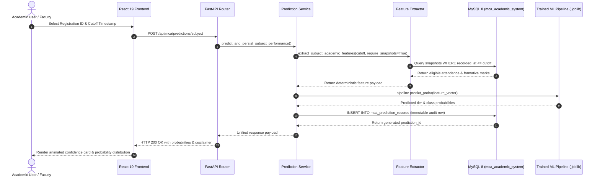

# System Architecture & Technical Specifications

**Project Title:** AI-Based Student Performance Prediction & Academic Support System  
**Academic Context:** Master of Computer Applications (MCA) — 3rd Semester Minor Project  
**Department:** Department of Computer Applications, University Institute of Technology — RGPV (Autonomous), Bhopal  
**Academic Session:** 2026–27  

---

## 1. High-Level Architecture Overview

The system is engineered as an educational data mining and decision-support platform designed specifically for the Master of Computer Applications (MCA) four-semester curriculum under UIT-RGPV autonomous regulations.

```
┌────────────────────────────────────────────────────────────────────────┐
│                        React 19 + Vite Frontend                        │
│   (Minimal Sidebar, Warm Ivory #F5F6F2, Responsive Navigation Drawer)  │
│  [Dashboard] [Curriculum] [Subject Pred] [Semester Pred] [History]     │
└───────────────────────────────────┬────────────────────────────────────┘
                                    │ HTTP / JSON REST APIs
                                    ▼
┌────────────────────────────────────────────────────────────────────────┐
│                        FastAPI Backend Engine                          │
│  - Endpoint Validation (Pydantic v2)                                   │
│  - Point-in-Time Temporal Cutoff Extraction Service (Phase 2E)         │
│  - Prediction Orchestration & Dual Pipeline Routing (Phase 3B)         │
│  - Diagnostic Health & Security Sanitization Gateways                  │
└──────────────┬──────────────────────────────────────────┬──────────────┘
               │                                          │
               ▼                                          ▼
┌──────────────────────────────┐        ┌────────────────────────────────┐
│  Scikit-Learn ML Pipelines   │        │     MySQL 8.0 Database         │
│  - Subject Level:            │        │  (mca_academic_system)         │
│    Logistic Regression       │        │  13 Approved MCA Tables        │
│    (macro-F1: 0.6732)        │        │  - Relational Snapshots        │
│  - Semester Level:           │        │  - Referential Integrity       │
│    Random Forest             │        │  - Append-Only Audit Trail     │
│    (macro-F1: 0.6973)        │        │    (mca_prediction_records)    │
└──────────────────────────────┘        └────────────────────────────────┘
```

---

## 2. Component Responsibilities

### 2.1 Frontend Client (React 19 + Vite)
- **State Management & Navigation**: Tab-based single-page architecture (`useState`) with persistent desktop sidebar and touch-friendly mobile drawer.
- **Views**:
  1. `Dashboard` (`McaOverview.jsx`): Real-time metrics (4 Semesters, 26 Courses, 2 ML Pipelines, 4 Tiers), visual trajectory distribution pill bars, quick-action launchpad, architectural pillars, REST endpoint reference, and synthetic dataset disclaimer.
  2. `Curriculum` (`McaCurriculumBrowser.jsx`): Interactive 4-semester scheme browser displaying all 26 canonical courses across 4 semesters (Semesters 1 and 3 verified under July 2025 and July 2024 schemes; Semesters 2 and 4 provisional pending university board publication).
  3. `Subject Assessment` (`McaSubjectPredictionForm.jsx`): Point-in-time single-subject evaluation interface enforcing explicit cutoff timestamps.
  4. `Semester Assessment` (`McaSemesterPredictionForm.jsx`): Student-level aggregate semester forecast with pill selector across Semesters 1–4.
  5. `History` (`McaPredictionHistoryPanel.jsx`): Immutable prediction record search by Student ID with expandable detailed probability and feature snapshot cards.
  6. `About` (`AboutModal.jsx`): Comprehensive institutional context, ML methodology, 4-tier grade boundary mapping, and ethical use guidelines.
- **Design System**: Warm ivory background (`#F5F6F2`), white cards (`#FFFFFF`) with subtle 1px borders (`#E3E7E0`), deep forest-green accents (`#2F5241`), soft sage surfaces (`#E8ECE6`), and DM Sans typography.

### 2.2 Backend Application (FastAPI + Python 3.14)
- **Routing Layer** (`app/routers/`):
  - `mca_curriculum.py`: Read-only access to canonical 26-course autonomous curriculum.
  - `mca_predictions.py`: Point-in-time subject and semester prediction endpoints with audit retrieval.
  - `predictions.py`: Legacy UCI routing maintained in strict isolation.
- **Service Layer** (`app/services/`):
  - `mca_feature_extraction.py`: Deterministic point-in-time extraction applying temporal cutoff boundaries ($\le t_{\text{cutoff}}$). Strictly forbids forward-looking mark inclusion.
  - `mca_prediction_service.py`: Orchestrates feature extraction, artifact model invocation, class probability extraction, and immutable persistence into `mca_prediction_records`.
- **Database Layer** (`app/database.py`):
  - Session lifecycle management via FastAPI dependency injection (`get_db`).
  - Connection pooling with `pool_pre_ping=True` and `pool_recycle=3600`.
  - Dialect-specific compiler hooks omitting problematic MySQL 8.0 auto-increment check constraints while retaining SQLite compliance.
  - Safe credential masking across diagnostic endpoints (`/health/db`).

### 2.3 Machine Learning Pipeline (`ml/src/`)
- **Dual Pipeline Architecture**:
  1. `mca_subject_logistic_regression`: Optimized multinomial Logistic Regression trained on 6,370 synthetic course-enrollment snapshots.
  2. `mca_semester_random_forest`: 100-estimator Random Forest classifier trained on 1,200 synthetic student-semester records.
- **Artifact Isolation**: Models and metadata are persisted in `ml/artifacts/mca/` as self-contained `.joblib` and `.json` artifacts independent of developer machine absolute paths.

---

## 3. Data Flow and Prediction Lifecycle



---

## 4. Key Architectural Safeguards

1. **Temporal Cutoff Boundary**: Every inference requires an explicit datetime cutoff. Any attendance, formative assessment, or result declared after this timestamp is strictly excluded to prevent future-data leakage.
2. **Missing Feature Transparency**: Missing snapshots are recorded as explicit `None` values and cataloged under `missing_feature_groups`. The system never synthesizes or fabricates default values (e.g. assuming 75% attendance).
3. **Immutable Persistence**: All generated predictions are saved with their full input feature snapshot in MySQL `mca_prediction_records` table, enabling complete retrospective audits.
4. **Synthetic Dataset Notice**: All API responses and UI cards present a mandatory disclaimer stating models were trained on synthetic UIT-RGPV-calibrated distributions.
